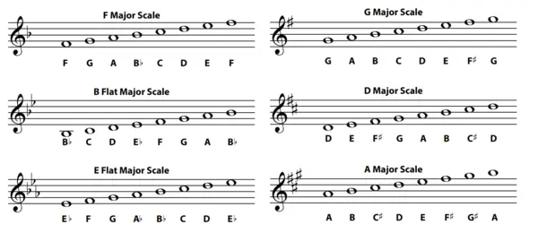
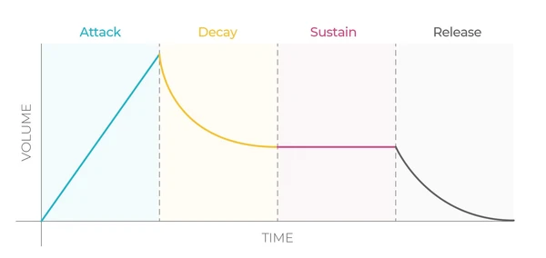
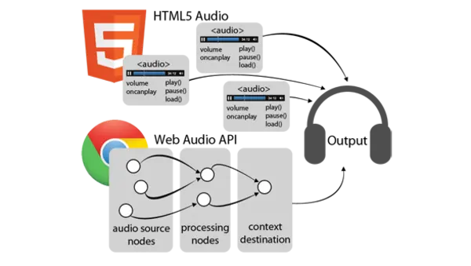
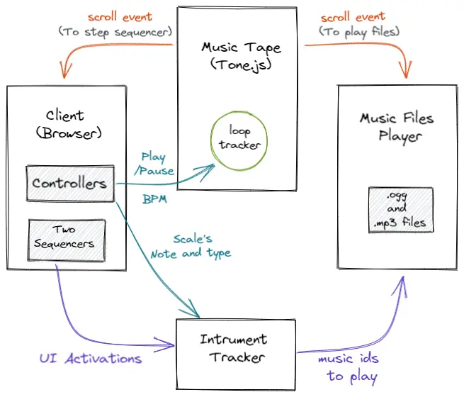

### Overview

Music is a means of self expression. It’s a way for one to project his inner life into the world.
I’ve been fascinated with music theory from setting up a structure to filling it in and I believe it is as deserving of exploration as anything else one can study.

But learning and playing music is a difficult beast to tame, many struggle with it, and some give up on it entirely.
I think that everyone should be able to create music, and in a way that doesn’t require them to know what a minor sixth is. 

For a long time I’ve been trying to find ways to play music without knowing anything, like just hitting random notes and strings and creating melody. The key realization was that I could use my existing skills and interests in software development and use them towards music. So I designed and created La Music, a music sequencer pre-configure to play, no need to know any chords or circle of fifths, just click random tiles and a melody will be generated.

### Research

#### Basic Music Theory
While reading Music Theory I found that, often in music, most or all of the melody and harmony is built using the notes of a single scale. Music scale is any graduated sequence of notes or tones ordered by fundamental frequency or pitch. So I started with this idea that users should use only one scale of notes at a time and other notes should not be allowed.

#### Timbre, attack and decay
Timbre is what makes a particular musical instrument or human voice have a different sound from another, even when they play or sing the same note. For instance, it is the difference in sound between a guitar and a piano playing the same note at the same volume. Both instruments can sound equally tuned in relation to each other as they play the same note, and while playing at the same amplitude level each instrument will still sound distinctively with its own unique tone color.

During the 1970s, the developers of the synthesizer discovered that the biggest challenge in making it sound natural wasn’t in reproducing another instrument’s timbre — which is what the engineers had primarily focused on from the onset — but in reproducing the attack and decay of each instrument.
Eventually, they had to record samples of the instruments themselves into the synthesizers in order to make sounds distinguishable from one another.

So to do this I downloaded royalty free real sounds of casio piano, consisting of Treble range notes. In addition to this I also decided to add percussion instruments beats for background sound, giving a complete music creation feeling.

#### Web Tools
Music on the web can be made and controlled by Web Audio API. The Web Audio API provides a powerful and versatile system for controlling audio on the Web, allowing developers to choose audio sources, add effects to audio, create audio visualizations, apply spatial effects (such as panning) and much more. Tone.js is a nice, extensive framework aimed to create music and play it in a web browser. It's built on top of the Web Audio API as an abstraction layer, which makes for a perfect tool to create music using JavaScript.

### Architecture
The core of the app has event-driven architecture, it relies upon interaction between four major components: the client, instrument tracker, the music files player and tape machine which is the heart of the app giving beats or periodic events.

When you click the start button, you’ll start a tape machine which will create a scroll event at BPM rate. This event is then used to iterate sequncer's tracking column. The tiles which are activated in current columns are then sent to Instrument tracker, which parses and maps the corresponding instrument to be played. The Music Player component then takes these parsed values and plays those files. 

I've also applied some simple algorithmic techniques to add rhythmic interest when multiple buttons are activated, giving rise to a somewhat pulse pattern of real instruments.

In the tape machine component, Tone.js provides a Transport API for tracking time, and loops for repeating beats or cycling across sequencer columns.

### Future Scope

1. **Download Functionality**: Downloading one's creation is the most important feature which is missing and I wish to add it as soon as possible.
2. **Collaborative Playing**: Another feature which i did like to implement is people playing on the same instance of web app at the same time. This could be done in multiple room like environment with each room hosting a group of users.