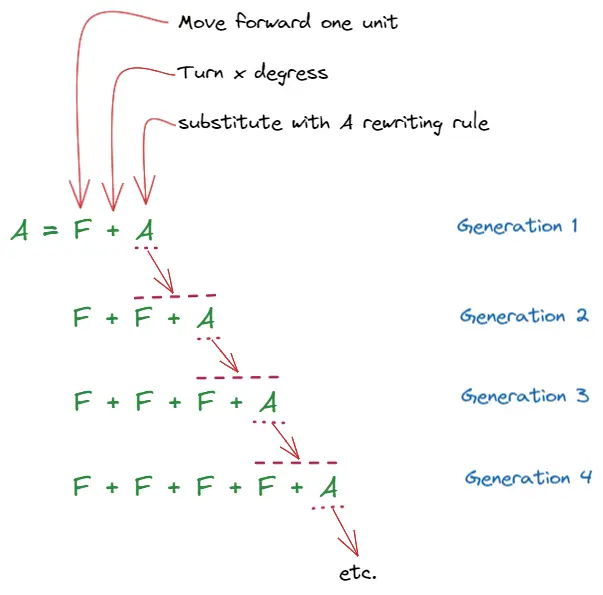
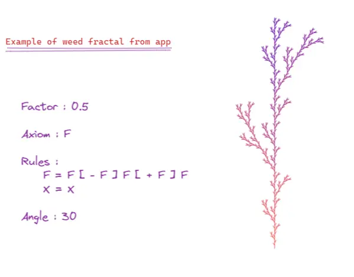
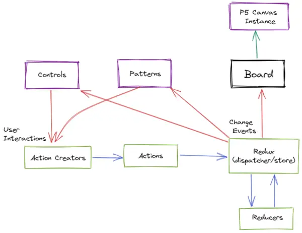

### Overview
For centuries humans have been inspired by nature's forms and geometries. Its structures, proportions, and patterns have influenced many mathematicians and philosophers. It is only in the past decades that much of the underlying logic, mathematics and chemistry of nature's forms has been better understood.
Most physical systems of nature are not regular geometric shapes of the Euclid's standard. And it is fractal geometry that offers ways of describing, measuring and predicting these natural phenomena.

Simply put, a fractal is a geometric object that is similar to itself on all scales. If you zoom in on a fractal object it will look similar or exactly like the original shape. This property is called self-similarity. Finding fractals in nature isn’t too hard – you just need to look. But creating them on screen is something else.

This web app explores the visual interpretation of fractals as geometric forms, it creates and describes how the famous fractals are created and explains the most important properties, which make them useful for different domains of science.

### Research

In the late 1960's, the biologist Aristid Lindenmayer proposed a string-rewriting algorithm that can model simplified plants and their growth processes. This theory is now known as L-Systems.
 
One can think of L-systems as containing the instructions for how a single cell can grow into a complex organism. L-systems can be used to specify the **rules** for all kinds of interesting patterns. Though originally designed for the modelling of plant topology, their capabilities have been extended enormously over the years as a modelling tool for complex computer graphics and animations capable of producing realistic results.
By the same token we can use it for creating fractal geometry.

Starting from any initial L-System grammar called **Axiom** the evolution proceeds via repeated random mutation and user selection. Sub-classes of the mutation process depend on the context of the current symbol being mutated.  As the grammar allows importation of rules, these rules can be mutated and selected as well. The mutated rules are then interpreted to create a fractal geometry.

### Architecture
Entire app is made in **React** and **Redux**. It has three major components: Controls , Board and Patterns.  The controls component is necessary to obtain the l-system values and store it in store. Patterns component is for pre-selecting l-system values of famous fractals, with just a click on patterns and iterations fractal will be composed.
 
 Behind the scenes, the app uses p5.js for displaying on canvas and tailwind and styled-components for css.
 

Since, the rules of an L-system are really a set of instructions for transforming one string into a new string, after a number of these string transformations are complete, the string contains a set of instructions.
The App primarily uses the concept of turtle graphics, borrowed from the Logo programming language, to translate individual letters into drawing commands.
My plan was to let these instructions direct a turtle as it draws a picture.

**Following characters are the commands for trutle**

|Character  |      Meaning|
| :-------------: |:-------------:| 
|   F	      |     Move forward by line length drawing a line|
|   f	      |     Move forward by line length without drawing a line|
|   +	      |     Turn left by turning angle|
|   -	      |     Turn right by turning angle|
|   \|	      |     Reverse direction (ie: turn by 180 degrees)|
|   \[       |      Push current drawing state onto stack|
|   \]	      |     Pop current drawing state from the stack|

**Change the following parameters to get different systems**

|Parameters| Meaning|
| :-------------: |:-------------:| 
| AXIOM  | initial string |
| RULES  | rewriting rule|
| STARTX | canvas starting width position|
| STARTY | canvas starting height position|
| LENGTH | step size|
| ANGLE  | degree of direction change|

Then increase (or decrease) **ITERATIONS** to get next generation.

The part I had the most trouble with in the application was syncing redux store changes to canvas. My original intention was that the Board component would get states values and pipe it to canvas, but for re-rendering canvas using p5 through it was difficult. So, I decided to use store value directly in the p5 instance and added only store observables to Bord, so that it can trigger re-render.

### Future Scope
#### Higher resolution Fractals
Currently iteration computation has a performance impact on application by being in the browser. This results in lower resolution fractals. In the future I'm planning to use the WebGL backend for the browser. This backend is up to 100x faster than the vanilla CPU in the browser.

#### Mobile Experience
After almost completing the project, I realized it would be impossible to make a good mobile experience for such an app, especially since the major components are created in such a way. I am currently planning to just make a responsive web app for mobile, but later I do wish to release it as an app on iOS/Android.