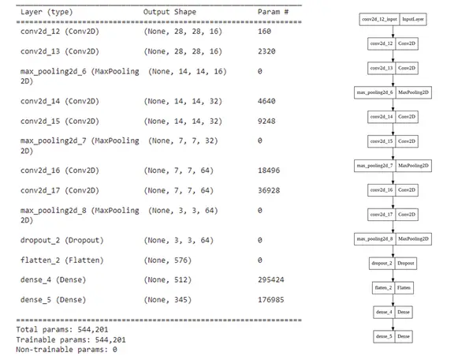
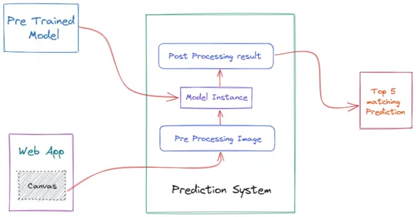

### Overview

From a young age, we develop the ability to communicate what we see by drawing on paper with a pencil or crayon. In this way we learn to express a sequential, vector representation of an image as a short sequence of strokes. However, we do not understand the world as a grid of pixels, but rather develop abstract concepts to represent what we see.

My goal was to train machines to predict and generalize abstract concepts in a manner similar to humans. As a first step towards this goal, I trained a deep learning model on a dataset of hand-drawn sketches, each represented as strokes of a pen. This potentially has many applications, from assisting the creative process of an artist, to helping teach students how to draw.

Every time you draw a sketch, a machine learning algorithm tries to analyse it and match a list of categories. Try drawing multiple sketches to find out!

### Research

In the last few years, deep learning has led to very good performance on a variety of problems, such as visual recognition, speech recognition and natural language processing. Among different types of deep neural networks, convolutional neural networks have been most extensively studied. Leveraging on the rapid growth in the amount of the annotated data and the great improvements in the strengths of graphics
processor units, the research on convolutional neural networks has emerged swiftly and achieved state-of-the-art results on various tasks.

The convolutional layer aims to learn feature representations of the inputs. The convolution layer is composed of several convolution kernels which are used to compute different feature maps. Specifically, each neuron of a feature map is connected to
a region of neighbouring neurons in the previous layer. Such a neighbourhood is referred to as the neuron’s receptive field in the previous layer. The new feature map can be obtained by first convolving the input with a learned kernel and then applying an element-wise nonlinear activation function on the convolved results.

I used Quick Draw, a dataset of vector drawings obtained from Quick, Draw!, an online game where the players are asked to draw objects belonging to a particular object class in less than 20 seconds. Quick Draw consists of 375 classes of common objects. Each class of Quick Draw is a dataset of 70K training samples, in addition to 2.5K validation and 2.5K test samples.

My model is a simple CNN architecture with several convolutional layers and pooling layer along with relu activation function, categorical cross entropy loss function and adam optimizer.

### Architecture

The Web App consists of two main components: UI consisting of canvas and CTA buttons and a module for using Tensorflow WEBGL backend for inference.

The canvas takes in a sketch as an input, and outputs a (480, 480) size image. This image is then fed to a preprocessor function which rescales and resizes it into (28, 28) size tensor with values in range (0, 1). The model takes that tensor as input and outputs a list of probabilities of all 375 classes, from which the app displays the top 5 ones.

## Future Scope

1. **Training with a more powerful model** : In future I'm planning to use MobileNets that are based on a streamlined architecture that uses depth-wise separable convolutions. These are used to build light weight deep neural networks for mobile and embedded vision applications.
2. **Predicting Different Endings of Incomplete Sketches** : It is also possible to finish an incomplete sketch by using the decoder RNN as a standalone model. I wish to add a feature that can generate a sketch that is conditioned on the previous points.
