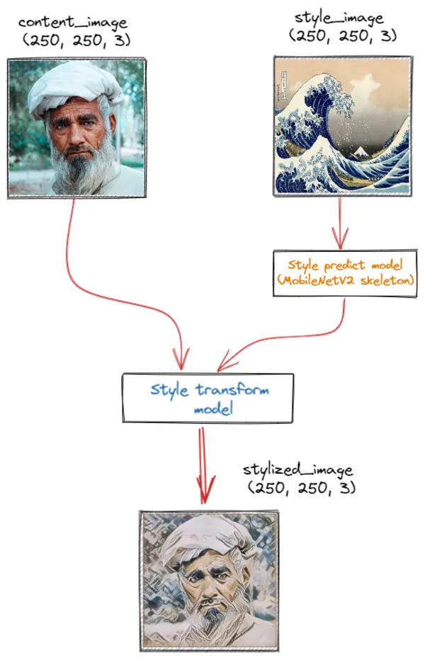
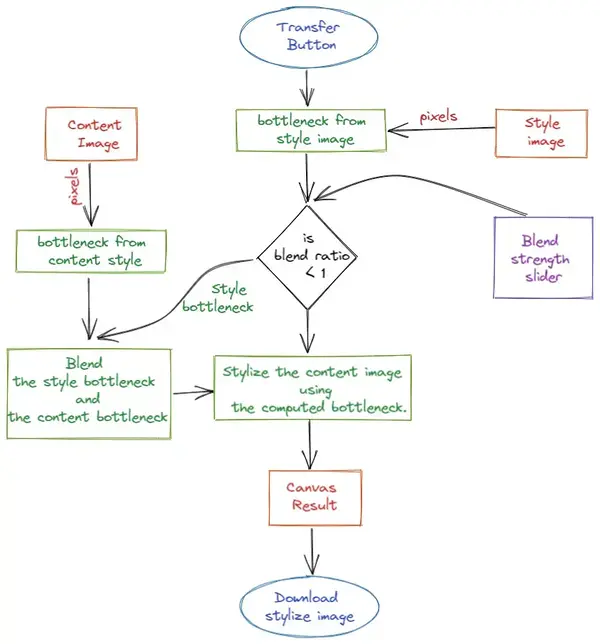

### Overview

If we’re being honest with ourselves, not everyone is born an artist. Some are more adept at language or other tactile tasks. In our school days, doing simple drawing assignments was also a difficult and lengthy process. I get a lot of people telling me that they used to be really into art when they were children but had to give it up because of a variety of reasons (and dearly wish they could make art again). But with recent advances in technologies like deep learning, almost anyone can enjoy the pleasure that comes along with creating and sharing an artistic masterpiece.

Style transfer is a computer vision technique that allows us to recompose the content of an image in the style of another. If you’ve ever imagined what a photo might look like if it were painted by a famous artist, then style transfer is the computer vision technique that turns this into a reality.

This new capability opens up endless doors in design, content generation, and the development of creativity tools and given this evolution, I decided to create a web app that can allow style transfer to be applied to any pair of images.

### Research

One of the most exciting developments in deep learning was [artistic style transfer](https://arxiv.org/abs/1508.06576). Using this technique, we can generate beautiful new artworks in a range of styles.
Style transfer is an example of image stylization, an image processing and manipulation technique that’s been studied for several decades within the broader field of [non-photorealistic rendering](https://en.wikipedia.org/wiki/Non-photorealistic_rendering).

Basically it is an optimization technique used to take three images, a **content** image, a **style reference** image (such as an artwork by a famous painter), and the **input** image you want to style — and blend them together such that the input image is transformed to look like the content image, but “painted” in the style of the style image.

Early versions of style transfer, however, were not without shortcomings. Because they treated the task as an optimization problem, it required hundreds or thousands of iterations to perform style transfer on a single image. To tackle this inefficiency, researchers developed what’s referred to as **fast neural style transfer**. Fast style transfer also uses deep neural networks but trains a standalone model to transform any image in a single, feed-forward pass. Trained models can stylize any image with just one iteration through the network, rather than thousands.

This fast neural style transfer model consists of two submodels:

1.  **Style Prediction Model**: A MobilenetV2-based neural network that takes an input style image to a 100-dimension style bottleneck vector.
2.  **Style Transform Model**: A neural network that applies a style bottleneck vector to a content image and creates a stylized image.

In addition to these we can blend the style of content image into the stylized output, which in turn making the output look more like the content image.

### App architecture

At core web app uses WebGL backend for the browser along with events to process client requests. It consists mainly of interaction between two major components: the User Interface and the Machine component which contains the main processing pipelines.

Pressing Transfer will start the styling process by emitting a style event. This is the start point given in the flow chart and rest of processes follow as shown respectively.

TensorFlow.js model converter is used to run pre-existing models in the browser.

So the entire process of getting your own artwork is in just three steps : Upload/Choose content, Upload/Choose content style and click Transfer.
Additionally style of content image can be blended into stylized output using blend strength slider.

### Reflection

#### Performance

Importing a pre-trained model from an external source has a performance impact on application. Images, for example, which are more than 250px in size, are significantly going to slow down transfer and may even crash the app.

#### Privacy and Speed

As the app does not need to send data to a remote server, transfer is actually faster. Even better, if you have direct access to the GPU, the app should run even faster.
